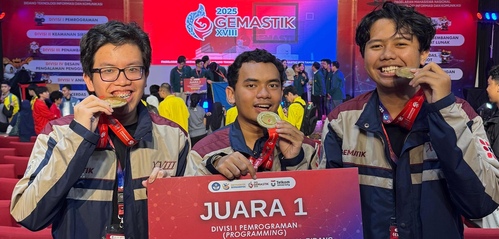

## Programming as a Passion

📅 Daily LeetCode · 🔥800+ Day Streak · 🏆Top 0.02% Contest Rating

## Projects

<b>GLARE - Glasses for Recognition</b>

Smart-glasses that recognize faces and display people's names in real time.

<table>
  <tr>
    <td width="25%">
      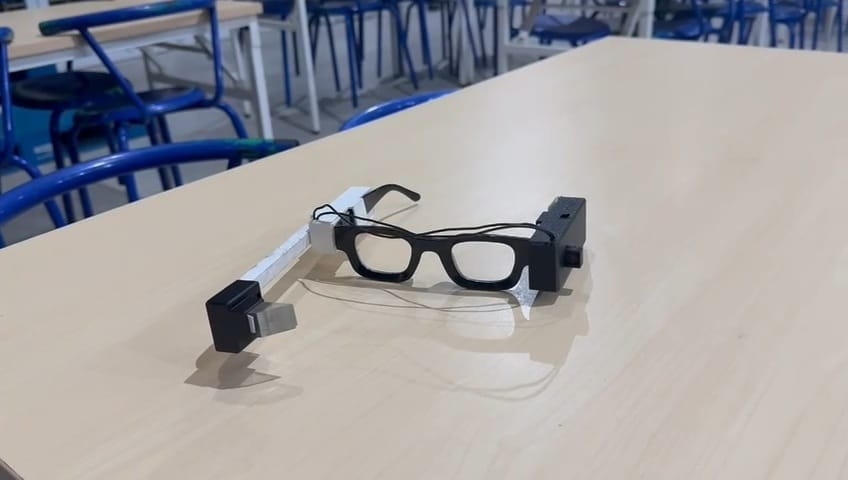
    </td>
    <td width="25%">
      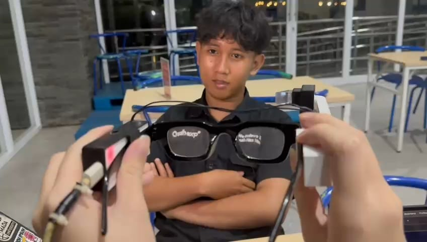
    </td>
    <td width="25%">
      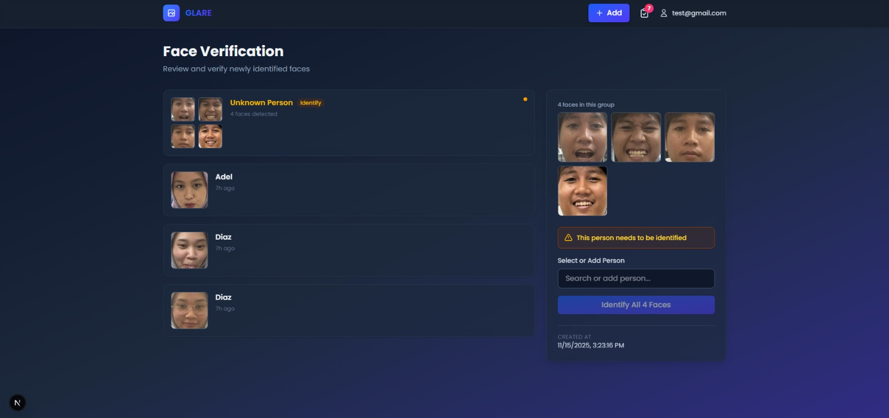
    </td>
    <td width="25%">
      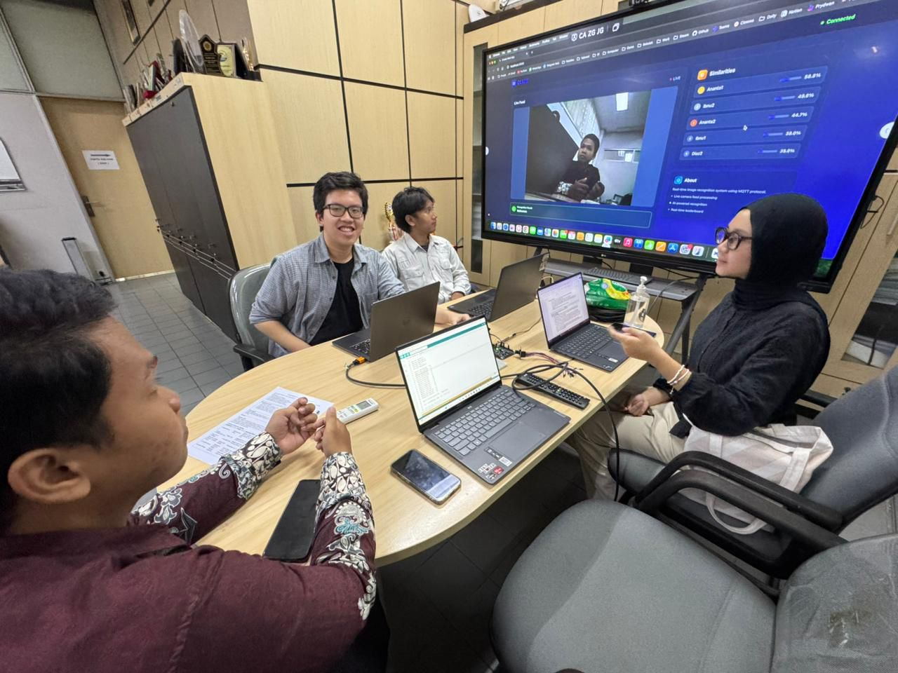
    </td>
  </tr>
</table>

- **Motivation**: Having met a lot of people, we may occasionally forget their names. We built a smart-glasses prototype to help with that as our capstone project.

- **Skills & Technologies**: `PyTorch` · `FastAPI` · `PostgreSQL` · `Next.js`

- **Links**: [Front-End Repository](https://github.com/Anantadhirya/glare-app) · [Back-End Repository](https://github.com/Anantadhirya/glare)

<b>Parallel Flash Attention</b>

A multi-GPU implementation of the FlashAttention algorithm, exploring parallelization strategies and analyzing scalability limitations.

<table>
  <tr>
    <td width="50%">
      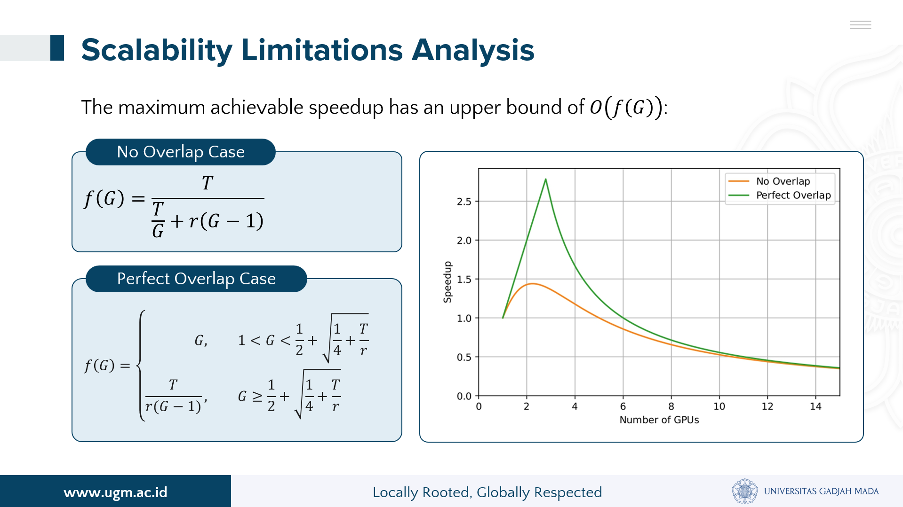
    </td>
    <td width="50%">
      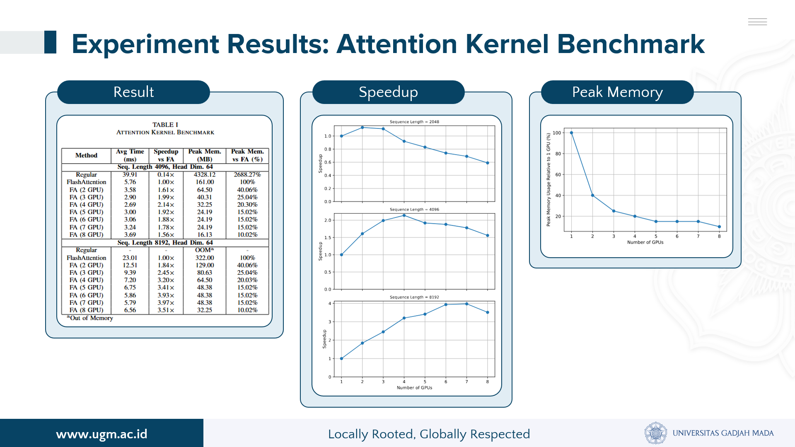
    </td>
  </tr>
</table>

- **Motivation**: Attention computation in large language models is computationally expensive, motivating multi-GPU parallelization to improve scalability. This project was conducted as my undergraduate thesis research.

- **Skills & Technologies**: `PyTorch` · `CUDA` · `LLMs` · `Parallel Computing`

<b>Ruma.AI</b>

An AI-powered elderly caregiver chatbot that uses large language models and speech technologies, developed for the Huawei Developer Competition APAC 2025.

<table>
  <tr>
    <td width="33%">
      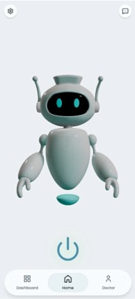
    </td>
    <td width="33%">
      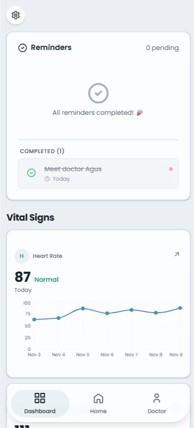
    </td>
    <td width="33%">
      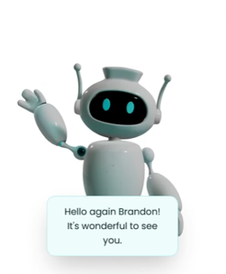
    </td>
  </tr>
</table>

- **Motivation**: We wanted to create a friendly, animated caretaker robot that makes elderly care more engaging and enables users to navigate the app through conversation. This project was developed for the Huawei Developer Competition APAC 2025.

- **Skills & Technologies**: `LLMs` · `Text-to-Speech` · `Speech-to-Text` · `Next.js` · `Three.js` · `WebSockets`

- **Links**: [Front-End Repository](https://github.com/Ruma-AI/ruma-fe) · [Back-End Repository](https://github.com/Ruma-AI/ruma-backend)

<b>Ecostyle</b>

An environmental education project that promotes recycling through a mobile application and an interactive card game, developed for the Indonesian Student Innovation and Entrepreneurship Festival (FIKSI) competition.

<table>
  <tr>
    <td width="33%">
      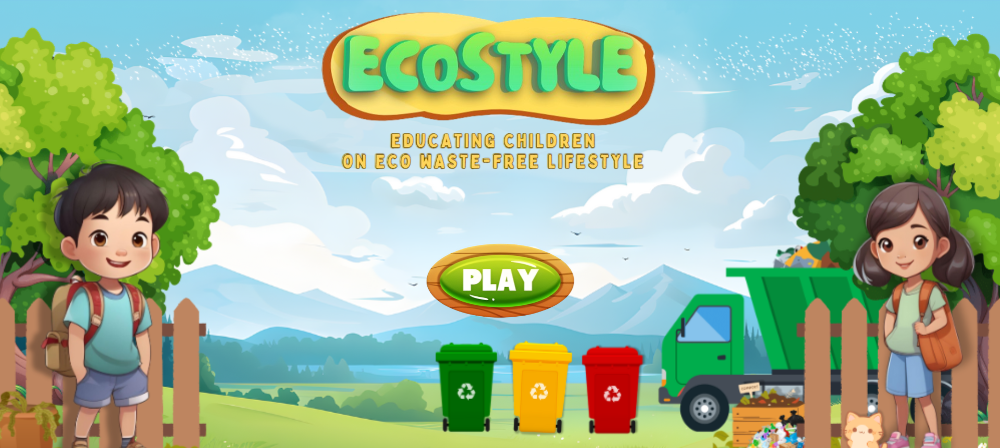
    </td>
    <td width="33%">
      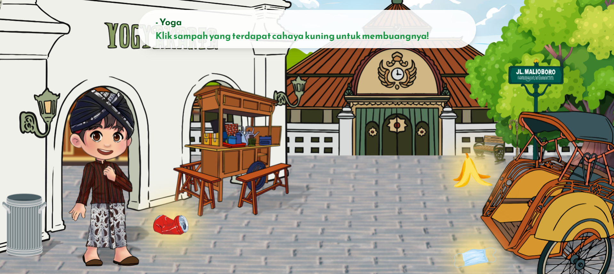
    </td>
    <td width="33%">
      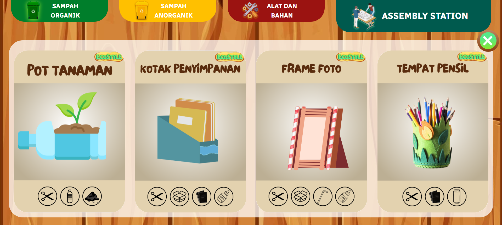
    </td>
  </tr>
</table>

- **Motivation**: To make recycling education more engaging and accessible through interactive storytelling, gamified learning, and augmented reality. Developed for the Indonesian Student Innovation and Entrepreneurship Festival (FIKSI).

- **Skills & Technologies**: `PWA` · `AR.js` · `A-Frame` · `Next.js` · `Blender`

- **Links**: [Repository](https://github.com/Anantadhirya/ecostyle) · [Demo](https://ecostyle.vercel.app/)

<b>Sigantara</b>

A Geographic Information System (GIS) that helps the government of Trimulyo Village record, manage, and visualize government-owned land.

<table>
  <tr>
    <td width="33%">
      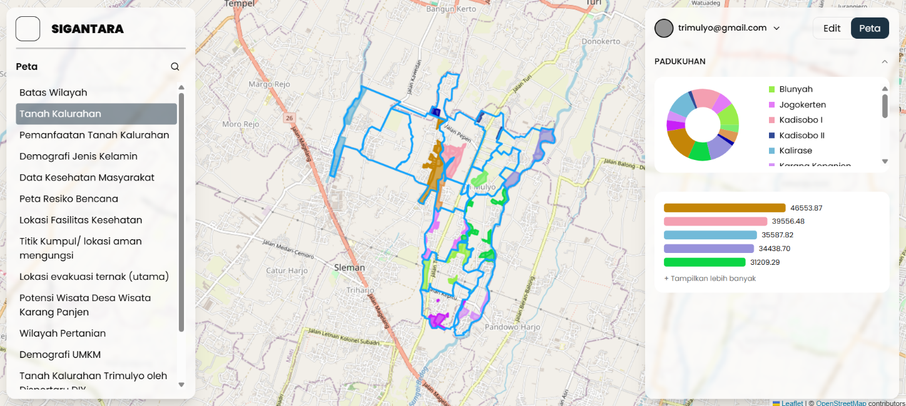
    </td>
    <td width="33%">
      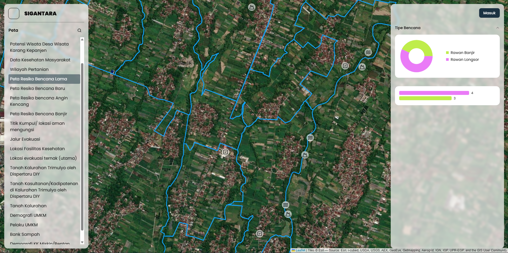
    </td>
    <td width="33%">
      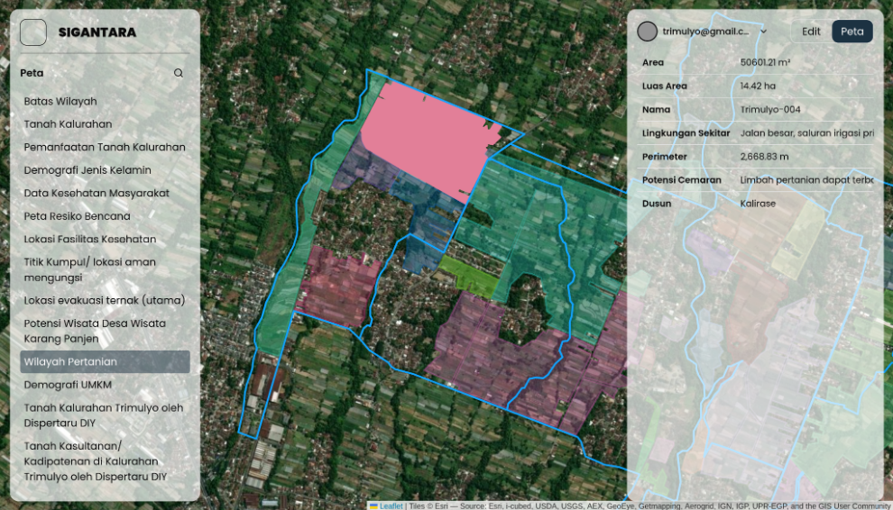
    </td>
  </tr>
</table>

- **Motivation**: To help the village government organize and visualize government-owned land records through an interactive geographic information system.

- **Skills & Technologies**: `Next.js` · `Firebase` · `Leaflet` · `GIS`

- **Links**: [Repository](https://github.com/KKNYO007/sigantara)

<b>Scheto</b>

A collaborative scheduling web application that helps users manage personal schedules and coordinate events with others in shared groups.

<table>
  <tr>
    <td width="25%">
      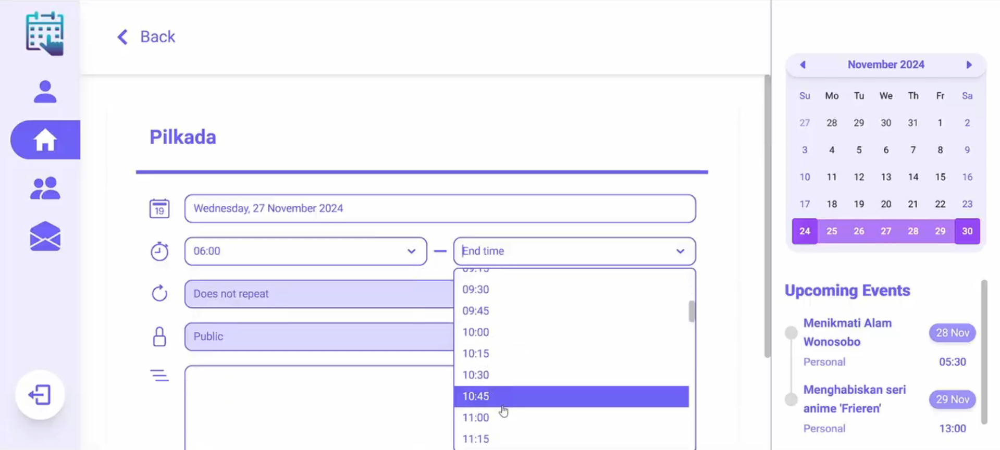
    </td>
    <td width="25%">
      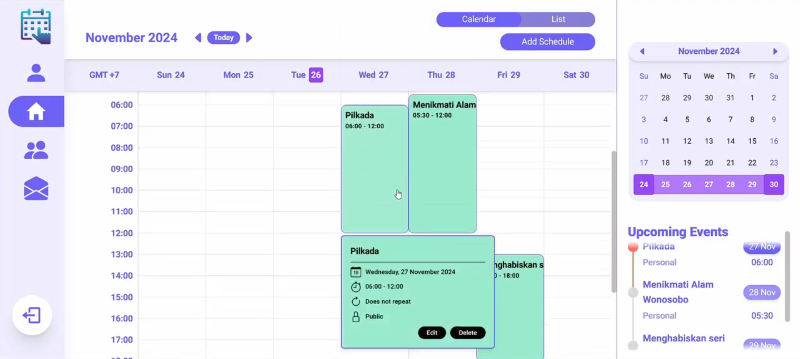
    </td>
    <td width="25%">
      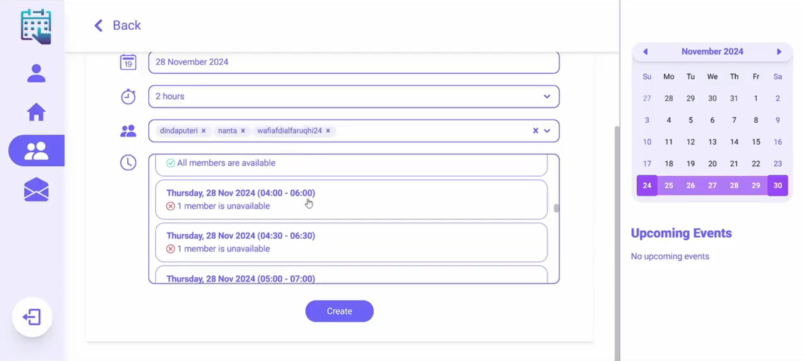
    </td>
    <td width="25%">
      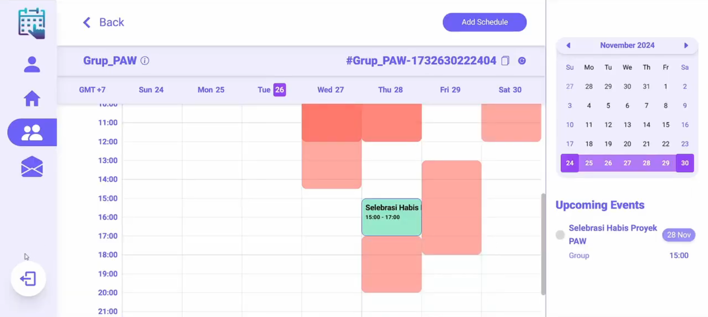
    </td>
  </tr>
</table>

- **Motivation**: This project was motivated by my personal experience with the difficulty of coordinating schedules for university group projects, as everyone has their own activities and commitments.

- **Skills & Technologies**: `Next.js` · `Express.js` · `MongoDB` · `Data Structures`

- **Links**: [Front-End Repository](https://github.com/Anantadhirya/fe-scheto) · [Back-End Repository](https://github.com/Anantadhirya/be-scheto)

## Connect

